# Dashboard tour

The dashboard has a built-in **Help** page (sidebar → Help). The same text is in
[help/guide.md](help/guide.md). It covers every section, current action caveats and
troubleshooting.

Every tab of the AgentWrangler dashboard, in the order the sidebar lists them, plus the
vocabulary the UI uses. For plain-language metric definitions, the dashboard itself ships a
glossary — sidebar → **"How to read this dashboard."**

<!--
  Screenshots on this page are captured from a SANITIZED instance (Vite test-mode fixtures —
  anonymized names, no live data) so no real workspace/repository names or paths are committed
  (privacy boundary). Regenerate against `npx vite --mode test`.
-->

## Choose a workflow

- **Where did the tokens go?** Start with [Workspaces](#workspaces), then [Sessions](#sessions).
- **What can I change, and did it help?** Follow the [worked recommendation example](getting-started.md#example-trim-always-loaded-context), then inspect [Recommendations](#recommendations).
- **What do the numbers mean?** Use the [glossary](#glossary-how-to-read-this-dashboard).
- **Why is my dashboard empty?** Check [first launch and scan state](getting-started.md#first-launch).

Animated synthetic dashboard walkthrough (optional)

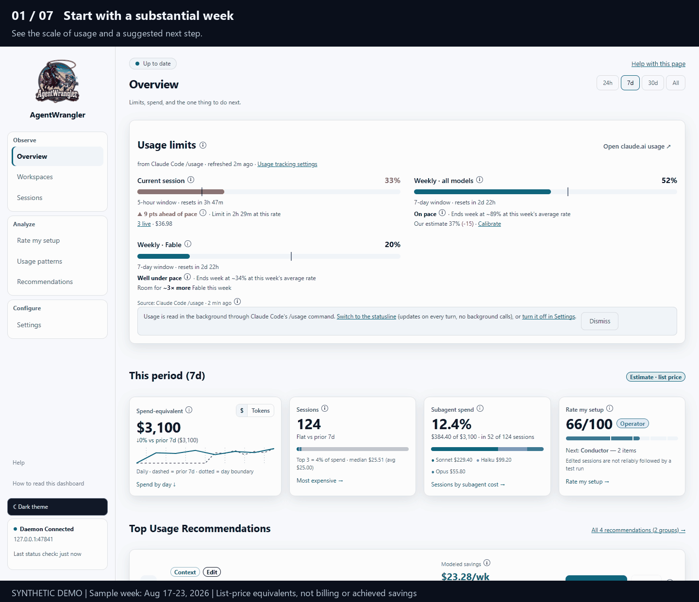

The screenshots and animation use the same synthetic heavy-use scenario: roughly $3,100
in weekly list-price equivalents and 19,400 turns across anonymized workspaces. These are
illustrative values, not a subscription bill or a promise of savings. The context-reduction
estimate uses removable tokens, observed turns, and a cache-read price; it is a projection.
The ledger shows separate seeded measurement examples, not the result of actions in the tour.

The animation steps through the main tabs of the synthetic dashboard. The static images
below provide an alternative to animation.

To reproduce the media, start an isolated `npx vite --mode test --host 127.0.0.1 --port 47841 --strictPort`
and use `scripts/demo/capture.js` with Playwright CLI, followed by `scripts/demo/compose.py`.
The capture script fixes the clock to the historical sample week; screenshots carry a
synthetic-data footer. Capture only the fixture instance.

## Overview

*Limits, spend, and the one thing to do next.*

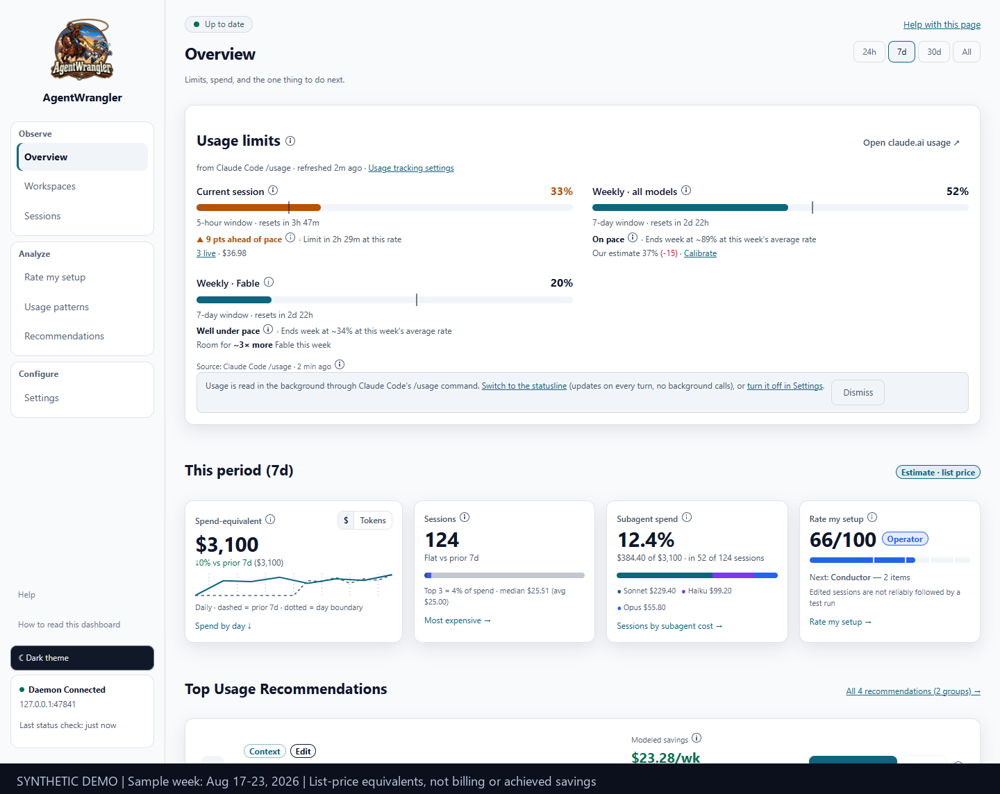

Top to bottom:

- **Usage limits card** — 5-hour and 7-day utilization with reset times, plus per-model weekly
  rows when available. By default AgentWrangler reads them by running your own
  `claude -p /usage` in the background, only while the dashboard is open: at most every 5
  minutes when you have been active, hourly when idle. It never reads your Claude login. A
  dismissible notice on the card says so. Turn it off in Settings → Usage limits from Claude
  Code, or switch to the Claude Code statusline (updates on every turn, no background calls).
- **Rate my setup card** — your setup score out of 100, tier, a "⚠ Capped" chip when a cap
  holds it, the next tier and how many items it needs, the change since your last grade, and a
  link to [Rate my setup](#rate-my-setup).
- **This period** — four KPI tiles for the selected window.
- **Top recommendations** — the highest-impact recommendation cards, with a link to the
  Recommendations tab.
- **Most expensive sessions** — up to five sessions over a fixed 7-day window, with peak
  context and subagent cost, one click from their detail pages.
- **Across the dashboard** — a short summary of the other tabs.
- **Context per turn** — a per-model table of average context per turn.
- **Where your tokens go** — a 100% bar of token flavors (input / output / cache write /
  cache read) and a weights table, with a basis toggle.
- **Spend by day** — one chart with three tabs.
- **Workspaces** — a table of spend by workspace.
- **Data notes** — caveats about the data behind the page.
- Date presets: **24h / 7d / 30d / all**. A first-run onboarding card tracks daemon → first ingest →
  scan completion. An empty history or completed scan without recommendations is valid; optional setup is not required.

A standing caveat banner keeps the economics honest: dollar figures are list-price
equivalents — subscription plans are not billed this way; tokens drive rate limits.

## Workspaces

*Spend efficiency by repository.*

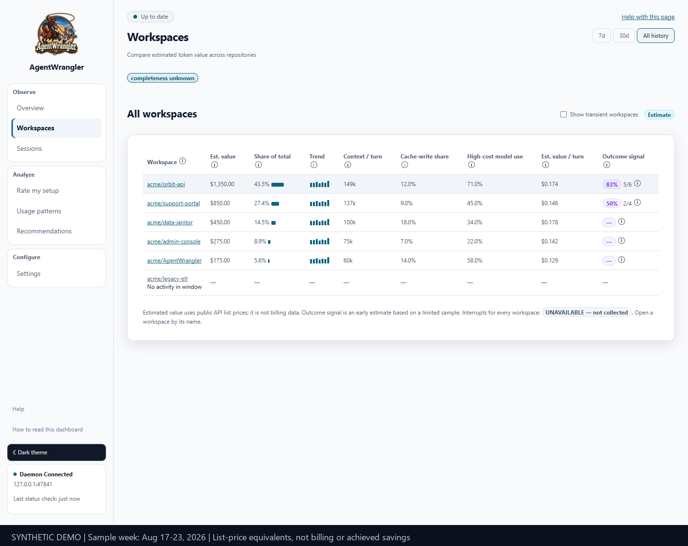

Columns: spend, share (inline bar), trend sparkline, context/turn, cache-write %, high-cost
model use (Premium %: Opus, Fable and Mythos), $/turn, and an experimental **success rate** when outcome linkage is
on. A toggle reveals transient (one-off directory) workspaces.

**Workspace detail** adds top sessions, a context-composition panel, and the outcomes table —
merged/closed PRs linked to the sessions that produced them, closure proxy, and
cost-per-success.

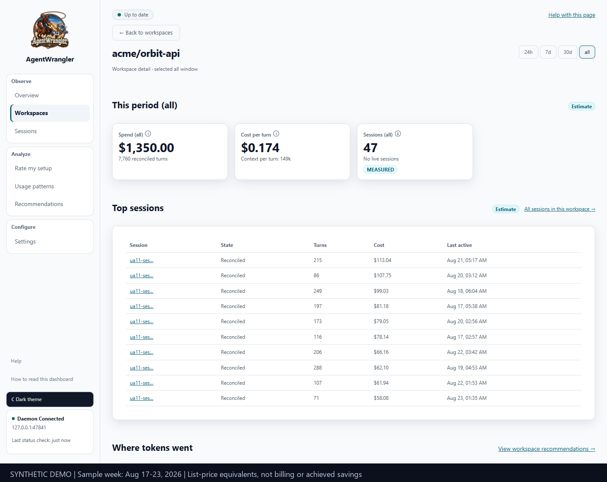

## Sessions

*Highest-cost sessions with output / context split.*

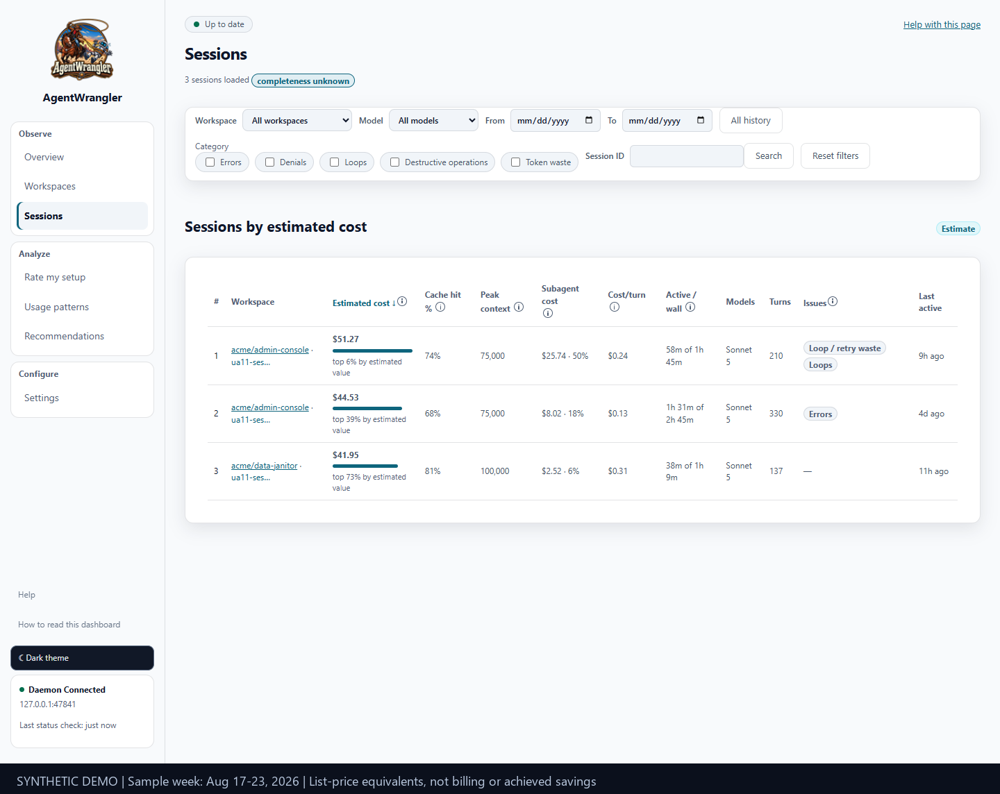

Each row: cost with a "top X% by estimated value" chip, cache hit %, peak context, subagent
cost, cost per turn, active / wall time, models, turns, issues, and last-active time. The
friction band is on the session detail page.

**Session detail** shows per-session KPIs (cost, $/turn, context/turn, duration, hygiene
flags, turns-to-first-commit), a **friction band** (low / elevated / high — from API errors,
tool errors, test failures, compactions, reprompts, and long gaps), the self-percentile chip,
a turn-by-turn timeline chart, and **cost drivers** — the detectors that fired on this
session with their measured shares — plus a guided fix prompt assembled only from measured
context.

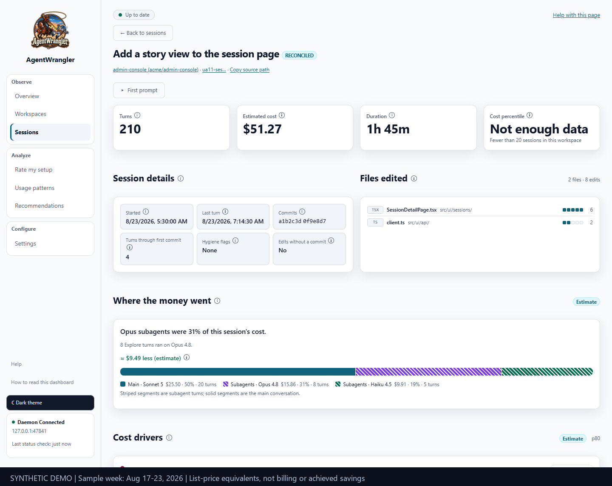

## Rate my setup

*Grade your Claude Code configuration and habits, and see what to fix next.* (Route
`#/judge-setup`; the old `#/briefs` link redirects here.)

- **Tier and score** — an overall score out of 100 and a tier: Drifter, Practitioner, Operator,
  Conductor, God-tier. The grade combines your settings with what your recent sessions show. A
  check without enough data is left out of the score, not counted as a failure. A fresh install
  may show **No tier yet** with the list of data it still needs.
- **Caps and gates** — a cap (for example a security finding) or a gate (a requirement for a
  tier) can hold the tier below what the raw score earns. The page then shows **⚠ Capped**, the
  reason, and the score before the hold.
- **To reach the next tier** — the items that block the next tier, each with the problem, what to
  do, what was seen, and a link to the fix or the cited Claude Code docs. Dollar figures appear
  only where a recommendation prices the gap.
- **Categories** — one tile per category with its score and pass / partial / fail / no-data
  counts. **Show checks →** opens the category's checks below the grid.
- **How this is graded** — the rubric: tier ladder and floors, category weights, gates, and the
  coverage and security-cap rules.
- **Change since last grade** — the score and tier delta vs. the previous grade (absent on the
  first run; flagged when the rubric changed).
- **Copy summary** — copies tier, scores and category labels as text; never paths, workspace
  names or config text.
- **Written review (optional)** — **Judge me** asks Claude for a written opinion on what the checks
  miss. It runs one request through your own `claude` CLI and login, typically about
  $0.30–$0.40 of your plan's usage. Nothing is sent until you approve a consent screen that shows
  the exact payload with redactions; you can add names to remove and choose which repos to
  include. The review is labeled "AI opinion (unverified)" and never changes the score or tier.

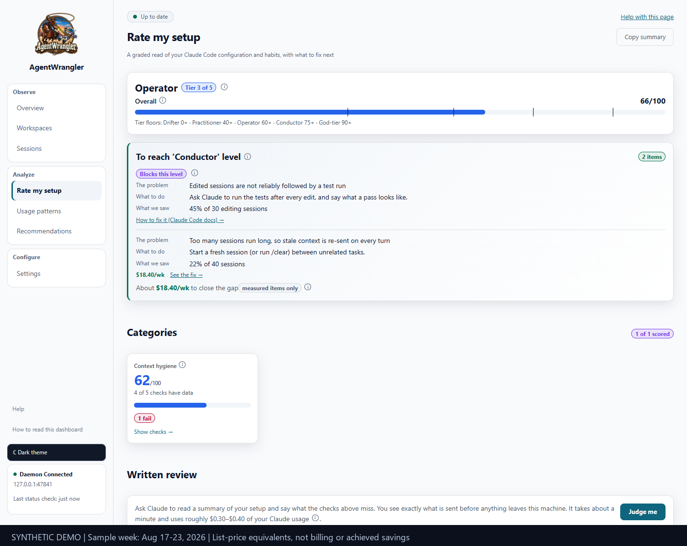

The Overview page's **Rate my setup** card shows the same score, tier and next step.

## Usage patterns

*What is costing you, why it happens, and the one fix for each cause.* (Route `#/diagnostics`;
window 7d / 14d / 30d.)

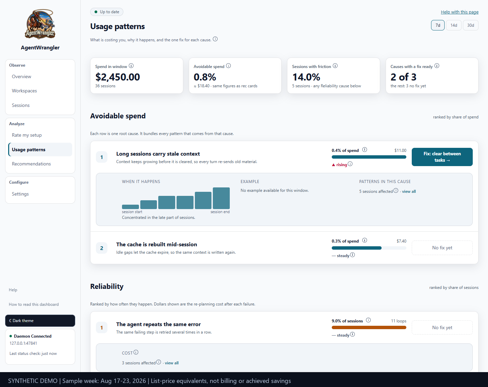

- **Tiles** — spend in the window, avoidable spend (the same figures as the recommendation
  cards), the share of sessions with friction, and how many causes have a fix ready.
- **Avoidable spend** — one row per root cause, ranked by share of spend, with its trend. Expand
  a row to see when in a session it happens, an example, and the affected sessions. A cause with
  a fix links to it; the rest say **No fix yet**.
- **Reliability** — failures such as repeated errors, ranked by how many sessions they affect.
  Dollars shown are the re-planning cost after each failure.

No findings can be a valid result for the selected window. See the
[Usage patterns guide](help/guide.md#diagnostics).

## Recommendations

*Ways to reduce token use. Review a suggestion, make a change, then check its effect.* Cards are
ranked by weekly impact. (The page is labeled **Early estimate** — estimates are not yet
validated.)

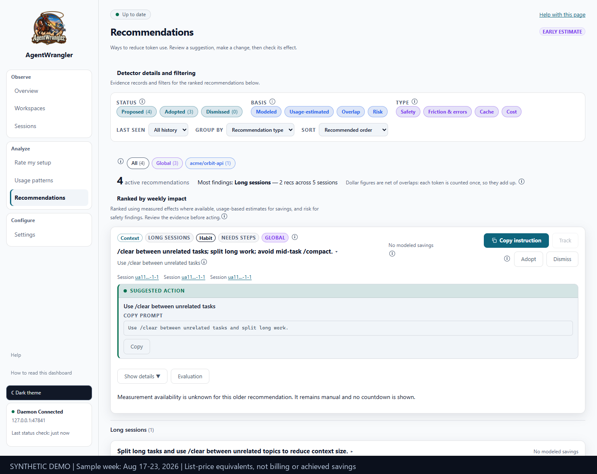

The detector families:

| Detector | Watches for |
|---|---|
| Cache misses | Broken prompt-cache reuse — flagged as the biggest single lever (~10× the impact of memory trims) |
| Session hygiene | Long sessions never `/clear`ed, mid-task compactions |
| Retry / redundant-read | Loops re-reading the same files or repeating failing calls |
| Tool-result bloat | Oversized tool outputs re-read every turn |
| Model routing | Opus turns doing Sonnet-shaped work |
| Limit warning | Burn pace vs. your weekly limit |
| Background sessions | Idle sessions still burning tokens |
| CLAUDE.md / memory | Oversized always-on instruction files |
| Tool catalog | Heavy MCP tool definitions loaded every turn |

Cards carry a confidence tier (**WARNING / ADVISORY / DIRECTIONAL / MODELED SAVINGS**), a
scope badge (global vs. workspace-scoped), and per-card actions: **Track** after the required
action evidence and confirmation, **Acknowledge** for unmeasured warnings, **Dismiss/snooze**,
**Install hook**, **Copy snippet**, **Copy instruction** or **Copy prompt**, **Review config** or
**Review edit**, **Adopt**, or **Open in Claude Code**. Open in
Claude Code is off by default; it shows only after you turn on Settings → Advanced →
Experimental actions. It opens your own `claude` in a terminal (on macOS, Terminal.app via
osascript, which triggers a one-time macOS Automation permission prompt). Nothing is applied
for you. Tracking records a baseline; it does not prove effectiveness and has no post-track
undo.
Below the cards: a published-best-practices scorecard, the **impact ledger** ("Adopted
changes — measured effect"), the dismissed cool-down list, and a detector-coverage strip.

The standing rule: *modeled savings are never counted as achieved; only verified measured
effects contribute to the achieved total.*

## Settings

*Daemon config · workspace names and paths · parser health.* Settings has four tabs:
Essentials, In-session guards, Integrations and Advanced.

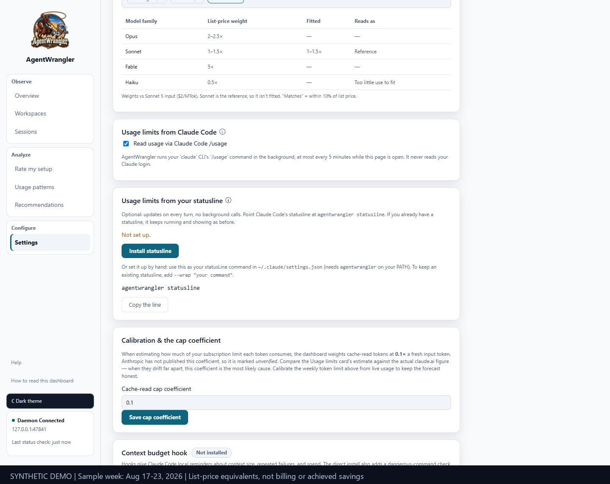

**Essentials**

- **Configuration** — calibrate the weekly token limit from live usage (one click,
  auto-saves); scan roots; activity window.
- **Usage limits from Claude Code** — the checkbox **Read usage via Claude Code /usage** (on
  by default). It runs your own `claude` CLI's `/usage` in the background, only while the
  dashboard is open, at most every 5 minutes when you have been active and hourly when idle,
  skipped while the statusline reading is fresh. It never reads your Claude login. It stores
  only percentages, reset times and model labels. `AW_USAGE_CLI=off` also turns it off.
- **Usage limits from your statusline** — optional alternative. **Install statusline** points
  Claude Code's statusline at `agentwrangler statusline`, which saves only the 5-hour and 7-day
  percentages and reset times. It updates on every turn and makes no background calls.
  AgentWrangler does not use your Claude login to call claude.ai. The 5-hour and weekly
  figures come from whichever reading is newer; per-model weekly rows come only from `/usage`.

**In-session guards**

- **In-session guards** — direct install adds five hooks; the copied prompt adds context-budget,
  loop, and burn only. Context-budget and burn warn, loop can deny repeated failures, and the
  direct-only dangerous-command guard can ask or deny. The direct-only PreCompact hook can make
  local raw-transcript checkpoint copies; see [Privacy](privacy.md#raw-transcript-checkpoint-copies).

**Integrations**

- **Workspace names and paths** — edit repo path / canonical name per workspace.
- **Outcomes sync** — with a GitHub token, reads outcome metadata at startup and on the scheduled
  pass; without a token it makes no GitHub requests.

**Advanced**

- **Manual limit override** — set the weekly limit by hand.
- **Bytes→token calibration** — opt-in, off by default (see [Privacy](privacy.md)).
- **Experimental actions** — shows **Open in Claude Code** on recommendation cards. There is no
  one-click apply in 0.2.0.
- **Parser health** and **Parse Failures** — read-only ingestion counters and the lines that
  could not be parsed.
- **Weekly Reports** — saved weekly reports.
- **Reset Database** — type the database name to confirm.

## Help

The **Help** link at the bottom of the sidebar opens the built-in Help page (route `#/help`):
task guides, troubleshooting, and setup and privacy notes. The same text is in
[help/guide.md](help/guide.md).

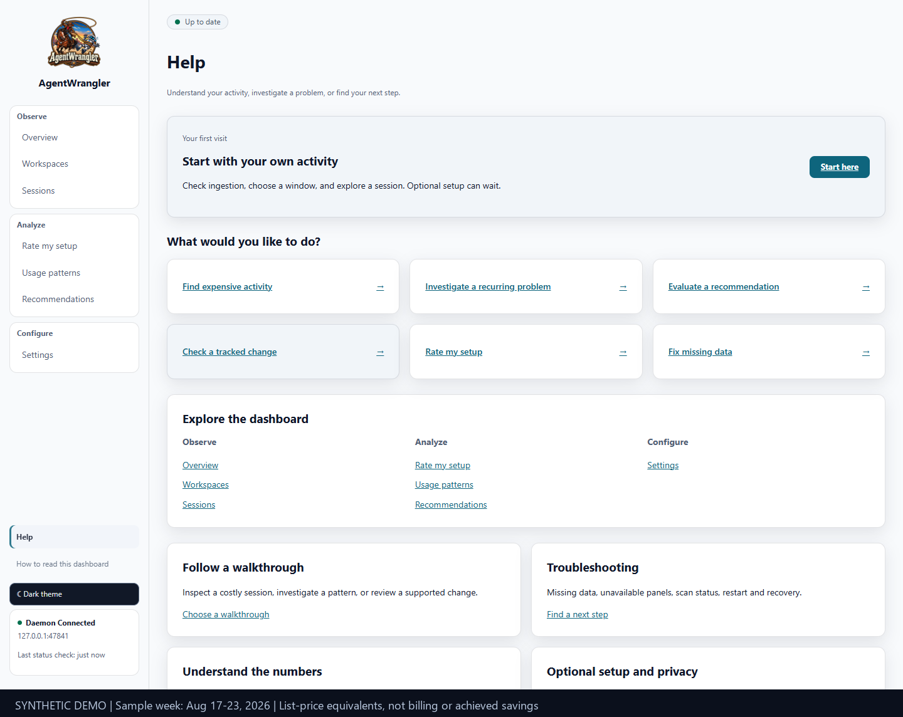

## Glossary ("How to read this dashboard")

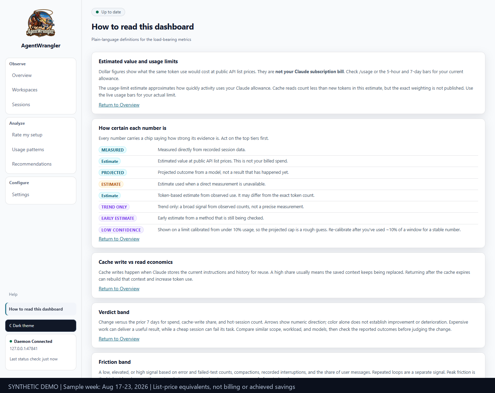

Plain-language definitions for every key metric, rendered with the same chip
components the rest of the UI uses:

- **Honesty tiers** — `EXACT` (counted), `LIST_EQUIV` (list-price equivalent), `MODELED`,
  `PROXY` / `OBS_PROXY`, `DIRECTIONAL`, `EXPERIMENTAL`, `LOW CONFIDENCE`.
- **Cap-weighted meter** — cache reads count far less against your rate limit than fresh
  input; the meter weights flavors accordingly.
- **Cache write vs. read economics**, **verdict band**, **friction band**, **offload share**,
  **self-percentiles**, and **linkage coverage**.
