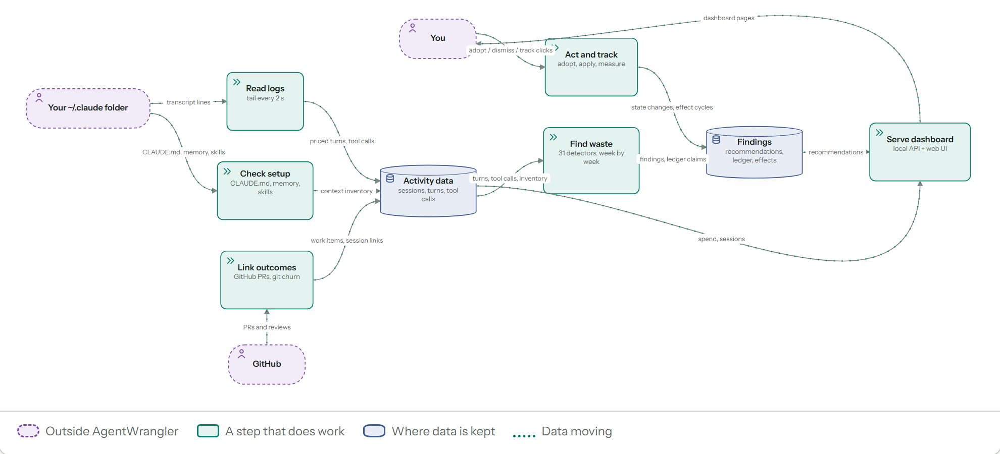

# How AgentWrangler works

A technical reference for people who want to know what runs on their machine. For setup, see
[Getting started](getting-started.md). For what data is read and kept, see [Privacy](privacy.md).

AgentWrangler is one local Node process (the daemon). It reads Claude Code's log files, stores what
it needs in a local SQLite file, runs detectors to find wasteful patterns, and serves a browser UI.
By default the only outbound call is your own `claude` CLI's `/usage`, for the usage-limits card (turn it off in
Settings). Everything else that leaves your machine is an optional feature that says so (see
[Privacy boundary](#privacy-boundary)).

Code references below are `file:line` in this repository.

## Background jobs

The daemon schedules its own work in memory. There is no job queue, jobs table or OS scheduled
task: stop the daemon and its background work stops. Every job can be re-run safely and picks up
from state already on disk (file offsets, per-week detector results).

| Job | What it does | When it runs | Code |
|---|---|---|---|
| Read new lines | Reads new bytes from known log files, hot files first | every 2 s; every file at least once per 5 min | `src/ingest/ingestor.ts:1077` |
| Find log files | Finds new log files and workspaces | every 30 s | `src/ingest/ingestor.ts:1187` |
| Detector walk | Runs detectors over weeks with new data | after ingest adds data; with no new data, at most once per 5 min | `src/daemon/detector-pass.ts:63`, `history-worker-runner.ts:43` |
| Recommendations build | Rebuilds the recommendation list snapshot | when its inputs change | `src/daemon/snapshot-service.ts`, `recs-worker-runner.ts:46` |
| Other snapshots | Usage patterns (diagnostics), efficiency headroom and slow-route snapshots | when their inputs change | `src/daemon/diagnostics-worker-runner.ts:43`, `headroom-worker-runner.ts:33`, `route-snapshot.ts:93` |
| Context probe | Re-reads always-loaded context (CLAUDE.md, memory files, …) | at boot, after scans, and every 10 min | `src/daemon/index.ts:329` |
| Outcomes sync | Links your sessions to GitHub PRs | every 10 min; does nothing without a token | `src/daemon/lifecycle.ts:93` |
| Weekly report | Builds the weekly report | weekly | `src/daemon/lifecycle.ts:101` |
| Calibration | Re-checks the bytes-per-token estimate (opt-in) | at boot if stale, then weekly | `src/daemon/lifecycle.ts:83` |
| Self-churn | Reads local git history for your own sessions | once, 60 s after boot | `src/daemon/index.ts:725` |
| Usage refresh | Runs your own `claude -p /usage` for the Usage limits card (on by default) | when the card is requested; at most every 5 min when you are active, hourly when idle, backoff after failures | `src/query/limits/cli-usage.ts` |
| WAL checkpoint | Keeps SQLite's write-ahead log small | every 1 s in a worker, plus every 30 s when idle | `src/daemon/wal-checkpointer.ts:60`, `lifecycle.ts:116` |

**Main thread vs worker threads.** Ingest and the HTTP server run on the main thread. Long CPU
passes (detector walk, recommendations, diagnostics, headroom, route snapshots, WAL checkpoint)
each run in a worker thread with its own database connection, so the dashboard stays responsive.

**No overlap.** A gate lets only one heavy job (detector walk, recommendations, diagnostics,
headroom) run at a time; the others wait their turn (`src/daemon/heavy-job-gate.ts:20`). Requests
for a detector walk that arrive while one is running are merged into a single follow-up walk
(`src/daemon/detector-pass.ts:111`).

**Change-gated.** A detector walk is skipped when nothing new was ingested, until a 5-minute idle
floor passes (`src/daemon/detector-pass.ts:105`). Snapshots are rebuilt only when their inputs
change, and the previous snapshot keeps being served while a rebuild runs
(`src/daemon/snapshot-service.ts`). Each recurring job and route has a declared time budget,
and a test fails if one is missing (`src/daemon/job-budgets.ts:43`, `route-budgets.ts:48`).

## Ingest

1. **Scan roots.** By default the daemon scans `~/.claude/projects` (`src/daemon/config.ts:19`).
   `AW_SCAN_ROOT` replaces it with one root (`config.ts:59`); a saved scan-roots setting also
   overrides it (`src/daemon/scan-roots.ts`).
2. **Discovery.** Each root is walked for `*.jsonl` files, including subagent transcripts
   (`src/ingest/discovery.ts:37`).
3. **Offsets.** For each file the daemon stores how far it has read, plus size, mtime and hashes
   of the file's head and tail, in `ingest_offsets` (`src/ingest/tail.ts:432`). Reading resumes
   from that offset. If a file shrank or its head or tail changed, it is read again from the start
   (`tail.ts:218`). The rows, offset and totals for a chunk commit together, so a crash never
   counts a chunk twice.
4. **Parse.** Each line is parsed (`src/ingest/parser.ts:102`). Each assistant message becomes one
   row in `turns`, and session totals are updated.
5. **Price.** Cost is tokens × list price per model and token type (input, output, cache read,
   cache write), kept as integer micro-dollars (`src/ingest/pricing.ts:52`). It is a list-price
   equivalent, not your bill. A model with no known price keeps its tokens but gets no cost.

## Storage

One SQLite file at `~/.agentwrangler/db.sqlite`, opened with better-sqlite3 in WAL mode. The schema
is a set of numbered SQL migrations in `src/db/migrations/`, applied at boot by `src/db/migrate.ts`.

| Group | Example tables |
|---|---|
| Usage | `workspaces`, `sessions`, `turns`, `tool_events`, `subagent_meta` |
| Ingest bookkeeping | `ingest_offsets`, `ingest_quarantine`, `pricing_snapshots`, `schema_migrations` |
| Context inventory | `context_inventory`, `context_inventory_history` |
| Detector results | `detector_week_results`, `detector_status_live` |
| Recommendations | `recommendations`, `recommendation_feedback`, `recommendation_effects` |
| Change tracking | `effect_cycles`, `effect_guardrail_results` |
| Outcomes | `work_items`, `session_work_links`, `observed_outcomes` |
| Other | `apply_jobs`, `user_config`, `reports`, `limit_snapshots` |

Column-level detail is in the
[Data model and metrics](planning/AgentWrangler_Data_Model_and_Metrics_v2.md) spec.

## Detectors → recommendations

- **Detectors** are registered in `src/detector/registry.ts:45`, one file each in
  `src/detector/detectors/`. Each looks for one pattern, such as a large always-loaded context or a
  repeated failing command.
- **Per-week results.** The engine runs detectors week by week. A closed week's result is reused
  unless new turns landed in that week (`src/detector/engine.ts:832`).
- **Findings become recommendations.** When a detector fires, the engine upserts a row in
  `recommendations` keyed by detector and scope (`src/detector/engine.ts:179`). Proposed
  recommendations that stop firing are cleaned up (`engine.ts:205`).
- **Cards.** The API serves each recommendation as a card (`src/query/api/recommendations.ts:104`):
  title, scope, modeled weekly savings, confidence, evidence, the weeks it fired, suggested actions
  and its state (proposed, adopted, and so on).

## Daemon and API

- **Binding.** The daemon listens on `127.0.0.1` only (`src/daemon/index.ts:813`), port 2929 by
  default, set by `AW_PORT` (`src/daemon/config.ts:22`).
- **Request checks.** Requests must name a loopback host: `127.0.0.1`, `localhost` or `[::1]`
  (`src/daemon/http.ts:54`). Writes must come from the same origin (`http.ts:65`). No permissive
  CORS headers are sent.
- **Routes** are in `src/daemon/router.ts`. Each declares a time budget in
  `src/daemon/route-budgets.ts:48`. The heaviest reads (recommendations, diagnostics, headroom)
  are served from snapshots built in worker threads.
- **Live updates.** The UI polls `/api/status` every 2 s while work is in progress
  (`src/ui/api/status-poller.ts:28`) and refetches when its `data_version` changes.

## Outcomes (GitHub)

Optional. With a GitHub token, every 10 minutes the daemon reads your PRs through the `gh` CLI,
links them to the sessions that produced them, and records what happened to them
(`src/daemon/outcomes-pass.ts:129`). The token comes from `AW_GITHUB_TOKEN`, or on Windows from
Credential Manager entry `AgentWrangler-GithubToken` (`src/outcomes/github/credential.ts:283`).
Without a token the pass is skipped and no `gh` process starts (`outcomes-pass.ts:123`).

## Acting on a recommendation

One-click apply is off in 0.2.0: the API returns 403 `APPLY_DISABLED`. AgentWrangler edits no files
for you. A card offers Copy prompt, Copy snippet, Install hook and Track. **Open in Claude Code**
shows only after you turn on Settings > Advanced > Experimental actions. It opens a terminal in the
workspace with your own `claude` (macOS: Terminal.app through `osascript`, which shows a one-time
macOS Automation permission prompt) (`src/apply/open-terminal.ts:155`).

## Hooks and statusline

Both are optional and installed only from Settings.

- **Hooks.** Installing writes entries to `~/.claude/settings.json`, after a backup
  (`src/hook/install.ts:24`). Each hook is a small Node script that Claude Code runs. It asks the
  local daemon over `127.0.0.1` (for example `/api/loop-guard`, `/api/context-budget`,
  `/api/burn-status`). The hooks are context-budget, loop guard and burn alert (before each tool
  call), dangerous-command (before Bash calls) and a PreCompact checkpoint.
- **Statusline.** `agentwrangler statusline` (`src/cli/statusline.ts`) reads the JSON that Claude
  Code passes to a statusline, prints one line, and saves only the 5-hour and 7-day limit
  percentages and reset times to `~/.agentwrangler/statusline-limits.json`. The daemon reads that
  file for the Usage limits card. The statusline command makes no network calls. With
  `--wrap "<your command>"` it also runs your existing statusline command. The card can also use
  `claude /usage` (see [Usage limits](#usage-limits)); per-model weekly rows come only from `/usage`.

## Usage limits

By default AgentWrangler runs your own `claude -p /usage` in the background, only while the
dashboard is open (`src/query/limits/cli-usage.ts`). It runs at most every 5 minutes when you have
been active and hourly when idle, is skipped while the statusline reading is fresh, times out
after 20 s and backs off after failures. Your own `claude` CLI makes the call; AgentWrangler never
reads your Claude login for it. It stores only percentages, reset times and model labels in
`~/.agentwrangler/usage-cli.json`. The 5-hour and weekly figures come from whichever reading
(statusline or `/usage`) is newer. A `/usage` reading older than 60 minutes shows as stale.

Turn it off with the checkbox **Read usage via Claude Code /usage** (Settings > Usage limits from
Claude Code) or `AW_USAGE_CLI=off`. The statusline (Settings > Install statusline) is the optional
alternative: it updates on every turn and makes no background calls.

## Privacy boundary

- **Local by default.** The daemon binds to loopback, and there is no telemetry or hosted backend.
  Inside the app, the local database may store and show secrets-filtered command text and error
  excerpts (see [Privacy](privacy.md)). Treat it as sensitive. Developer transcript and PR content
  is never committed or published.
- **What can leave the machine:**
  - By default, only your own `claude` CLI's `/usage` call for the Usage limits card (see
    [Usage limits](#usage-limits)). Turn it off in Settings or with `AW_USAGE_CLI=off`.
  - Everything else is opt-in: GitHub outcomes sync, through `gh`, with your token.
  - Bytes-per-token calibration, off by default. It sends sampled text to Anthropic's
    token-counting API with your own API key (`src/detector/calibration.ts:9`). The daemon reads
    `ANTHROPIC_API_KEY` only for this call.
  - Rate my setup's **Judge me**, through your own `claude` CLI, after you approve the exact payload
    (`src/judge/judge-service.ts:334`).
  - **Open in Claude Code** (off by default) starts your own `claude` in a terminal you can see.
    AgentWrangler sends nothing itself.
- **Your `claude` runs on your login.** `ANTHROPIC_API_KEY` is removed from the environment of every
  `claude` AgentWrangler starts (Judge me, Open in Claude Code, `/usage`), so they use your Claude
  subscription login (`src/shared/claude-child-env.ts`).
- **Claude login status.** Only `GET /api/oauth/status` reads the Claude Code login
  (`~/.claude/.credentials.json`, and on macOS the Keychain item `Claude Code-credentials` through
  the `security` tool, 3 s timeout, cached 60 s). It reports whether you are signed in and your
  plan tier. The token is never returned, logged, stored or sent. macOS may show a Keychain access
  prompt. The GitHub token is separate: `AW_GITHUB_TOKEN`, or on Windows Credential Manager (passed to `gh`).
